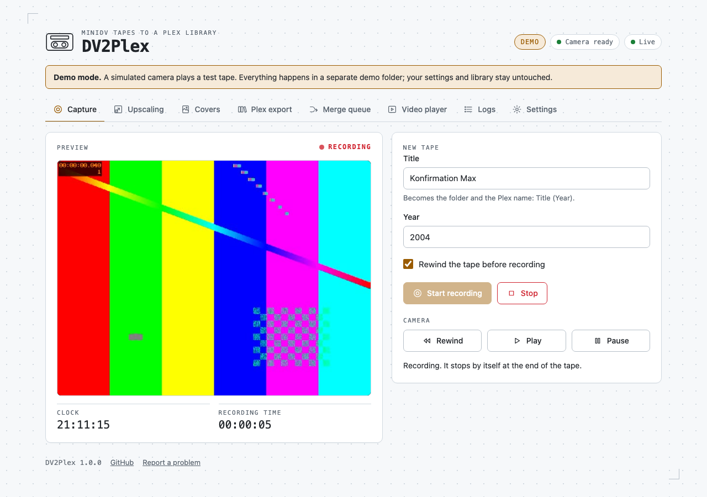
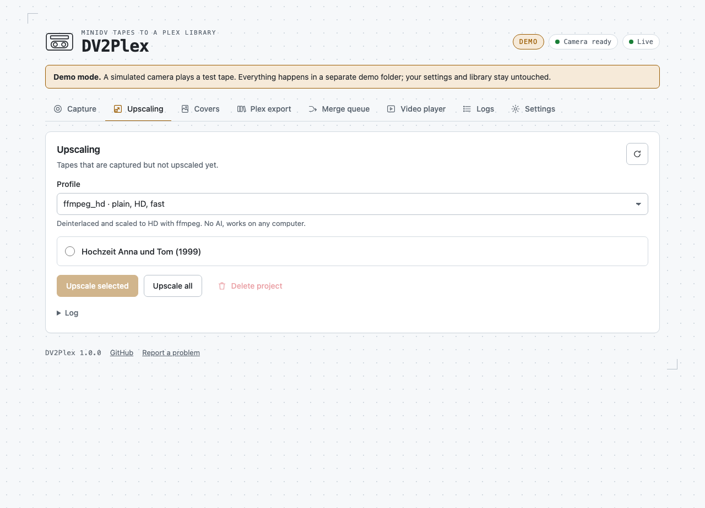
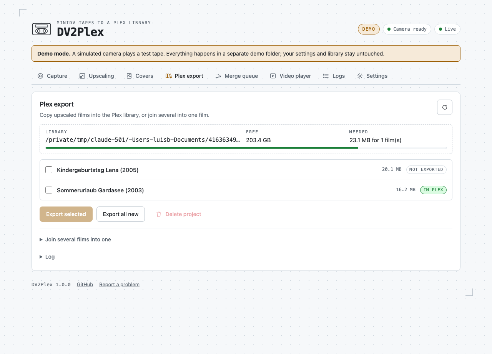
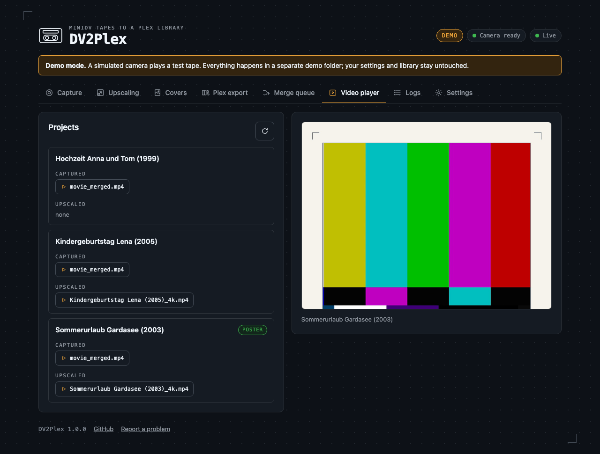
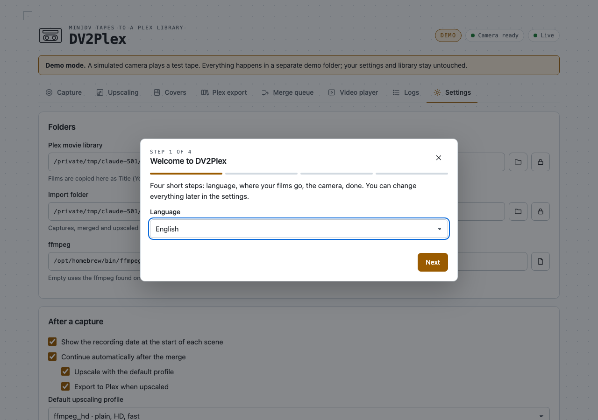

<picture>
  <source media="(prefers-color-scheme: dark)" srcset=".github/readme/banner-dark.svg">
  
</picture>

**MiniDV tapes to a Plex library.** DV2Plex captures tapes over FireWire, merges the scenes,
upscales them with Real-ESRGAN or ffmpeg, makes a poster, and exports the result as
`Title (Year)` into your Plex movie library. It runs as a desktop app or headless on a server.

It is for anyone with a box of MiniDV tapes, a camera or deck that still plays them, and a
Plex server that should end up holding the films. Capture needs Linux with a FireWire port;
everything after the capture also runs on Windows and macOS.

[Quick start](#quick-start) · [How it works](#how-it-works) · [Installation](#installation) · [Usage](#usage) · [Limits](#limits) · [Development](#development)



## Quick start

**Try it without a camera:** install the desktop app from the
[releases](https://github.com/FutureMan0/DV2Plex/releases) and start it with `--demo` (on
Windows the start menu has *DV2Plex (demo without a camera)*), or from a checkout:

```bash
pip install -r requirements-dev.txt
python -m dv2plex --demo
```

A simulated camera plays a test tape; capture, merge, upscaling, poster and export all run
for real, in a separate demo folder.

**Capture real tapes** on Linux with a FireWire port and a MiniDV camera or deck:

```bash
git clone https://github.com/FutureMan0/DV2Plex.git
cd DV2Plex
./setup.sh   # installs dvgrab, ffmpeg, the FireWire libraries and ./venv
./run.sh     # desktop window; add --server to run headless on port 5000
```

## How it works

<picture>
  <source media="(prefers-color-scheme: dark)" srcset=".github/readme/flow-dark.svg">
  
</picture>

1. **Capture** with dvgrab. Rewinds the tape, records it over FireWire and splits it into clips
   at every scene change, with a live preview while it records.
   → `DV_Import/<project>/LowRes/splits/`
2. **Merge** with ffmpeg. Joins the clips in recording order into one film and burns in the
   recording date at the start of each scene.
   → `LowRes/movie_merged.mp4`
3. **Upscale** with Real-ESRGAN or ffmpeg, using one of six profiles from fast to highest
   quality. DV is deinterlaced first; the film keeps the tape's shape (a 4:3 tape becomes
   2880 × 2160 in the 4K profiles).
   → `HighRes/<project>_4k.mp4`
4. **Poster** *(optional)* from a frame of the film, with its title and year; or a cover made
   with Stable Diffusion.
   → `poster.jpg` next to the film
5. **Export** into the Plex movie library, film and poster, named the way Plex expects.
   → `<Title (Year)>/<Title (Year)>.mp4`

Merging starts by itself after each capture; the **Merge queue** tab shows it. With
*Continue automatically after the merge* switched on, upscaling and export follow too.

## Installation

### Desktop app (Windows, macOS, Linux)

Download from the [releases](https://github.com/FutureMan0/DV2Plex/releases); no Python needed.
It contains ffmpeg and everything except Real-ESRGAN and Stable Diffusion, which need a
Python installation (below). The builds are not signed:

- **Windows:** `DV2Plex-<version>-windows-x64-setup.exe`. Windows SmartScreen warns about an
  unknown publisher: *More info*, then *Run anyway*. Installs for your user, no administrator
  rights. The window needs the Edge WebView2 runtime, which Windows 11 has.
- **macOS:** `DV2Plex-<version>-macos-arm64.zip` (Apple silicon) or `…-x86_64.zip` (Intel).
  Unzip, move `DV2Plex.app` to *Applications*, and open it the first time with a right-click
  and *Open*.
- **Linux:** `DV2Plex-<version>-linux-x86_64.tar.gz`. Unpack and run `./install.sh`; DV2Plex
  appears in your application menu. For capture install `dvgrab` (`sudo apt install dvgrab`).

On first start an assistant asks for the language, your Plex library and import folder, and
looks for the camera. The app tells you when a new release is out (it asks GitHub once a day;
switch that off in the settings). It keeps its settings in your user folder: `%APPDATA%\DV2Plex`,
`~/Library/Application Support/DV2Plex` or `~/.config/dv2plex`.

### Python installation (all features, servers)

Requirements:

- **Linux** for capture: [dvgrab](https://github.com/ddennedy/dvgrab) only exists there.
  Windows and macOS can do everything else.
- **A FireWire (IEEE 1394) port** and a MiniDV camera or deck with a DV out.
- **Python 3.10+** and **ffmpeg** (with libfreetype for the date overlay).
- **Disk space:** DV runs at about 13 GB per hour of tape, before upscaling.
- **A GPU** for Real-ESRGAN: NVIDIA (CUDA) or Apple silicon. On the CPU it takes days per tape.

With the setup script on Linux:

```bash
./setup.sh
```

It installs what is missing through `apt`, `dnf` or `pacman`: Python 3.10+, pip, dvgrab,
ffmpeg and the FireWire libraries (`libraw1394`, `libavc1394`). Then it creates `./venv`,
installs `requirements.txt` into it, downloads Chromium for Playwright (posters) and installs
the systemd service. Run it with `source setup.sh` to keep the virtual environment active.

By hand (Linux; on Windows and macOS skip dvgrab and the FireWire libraries):

```bash
sudo apt install dvgrab ffmpeg libraw1394-dev libavc1394-dev  # Debian, Ubuntu
python3 -m venv venv
source venv/bin/activate
pip install -r requirements.txt
python -m playwright install chromium
```

The Real-ESRGAN weights are downloaded on first use into `dv2plex/bin/realesrgan/weights/`.

### Find the camera

```bash
./setup_device.sh    # runs dvgrab --list
```

Automatic detection usually works; if not, put the device into `device.firewire_device` in the
settings. Settings → *Run the first-start assistant* checks the camera too.

### Updating

**Desktop app:** install the new release over the old one; your settings stay.

**Git installation:** `git pull`, or the updater in Settings → *Updates* (automatic updates
are off by default). **Coming from 1.x:** read [docs/MIGRATION.md](docs/MIGRATION.md). In
short: the settings move to `settings.local.json` by themselves, and the server listens on
`127.0.0.1` from now on, so a server you reach from other machines needs `server.host` and
the API token.

## Usage

### Start

```bash
./run.sh                                # desktop window with its own local server
./run.sh --server --port 5000           # headless web server on 127.0.0.1
./run.sh --server --host 0.0.0.0        # headless web server, reachable from the network
./run.sh --url "http://host:5000/?token=<token>"   # desktop window for a server elsewhere
./run.sh --share                        # desktop window, server also reachable on the LAN
./run.sh --demo                         # demo workspace with a simulated camera
./run.sh --show-token                   # print the API token
```

`python -m dv2plex` (or `dv2plex` after `pip install .`) takes the same options.
`python -m dv2plex --demo-run` runs capture, merge, upscaling, poster and export once without a
window and prints a report. `./run.sh --no-gui` starts the server through `sudo`, so dvgrab
and the camera control keep their rights for the whole session.

### Capture a tape

1. Connect the camera over FireWire and switch it to playback (VCR) mode.
2. Open the **Capture** tab and enter the title and the year. They become the project name
   and, later, the Plex folder: `Title (Year)`.
3. Start the recording. DV2Plex rewinds the tape and records until you stop it or the tape
   ends; the preview shows what arrives.
4. The camera rewinds afterwards and the clips are merged in the background. Upscaling,
   posters and the export run from their tabs, or by themselves if you switch that on.

### The interface

English by default, German in Settings → *Appearance* (or taken from the browser). Light and
dark follow the system. Its tabs:

| Tab | What it is for |
| :-- | :-- |
| Capture | Live preview, record, rewind, play, pause |
| Upscaling | Upscale captured tapes with a profile |
| Covers | Make posters for upscaled films |
| Plex export | Export films (one, or all new ones), join several films into one |
| Merge queue | Merges that are waiting or running |
| Video player | Watch, rename and delete projects |
| Logs | Live log of every step |
| Settings | Folders, automation, appearance, this installation, updates |

| | |
| :-- | :-- |
|  |  |
|  |  |

### Access and the API token

The server listens on `127.0.0.1` unless you pass `--host`, `--share` or set `server.host`.
Each installation has an API token, created on the first start and stored as
`server.api_token` in the settings; the environment variable `DV2PLEX_TOKEN` takes precedence.
`python -m dv2plex --show-token` prints it, and the server log says where it comes from.

- **On `127.0.0.1`**, four routes need the token because they run `sudo` or list folders:
  `/api/browse`, `/api/chown`, `/api/fix-config-permissions` and `/api/update/run`. The desktop
  window opens the page with the token. Other web pages cannot reach the server: it answers
  only to this machine's names and refuses changes that do not come from its own page.
  Behind a reverse proxy, add its name to `server.allowed_hosts`.
- **On any other host** every `/api` request and the WebSocket need it. Open
  `http://<server>:5000/?token=<token>` once; the page keeps the token in the browser.
- **Scripts** send it as a header:

  ```bash
  curl -H "X-DV2Plex-Token: <token>" http://127.0.0.1:5000/api/status
  ```

  `Authorization: Bearer <token>` works too.

The server speaks plain HTTP, so on a network the token travels unencrypted. Bind to the
network only on one you trust, or use an SSH tunnel (`ssh -L 5000:localhost:5000 user@server`)
and leave it on `127.0.0.1`. More in [SECURITY.md](SECURITY.md).

### Configuration

Settings live in `dv2plex/config/settings.local.json` (desktop app: in your user folder),
created on the first start and ignored by git; most of them are on the Settings tab. Missing
keys fall back to the defaults in [`dv2plex/config.py`](dv2plex/config.py), and
[`config/examples/example_configuration.json`](config/examples/example_configuration.json)
shows a complete file.

| Key | Meaning |
| :-- | :-- |
| `paths.dv_import_root` | Where captures, merges and upscaled films are kept |
| `paths.plex_movies_root` | Your Plex movie library, the export target |
| `paths.ffmpeg_path` | ffmpeg binary; empty uses the one on `PATH` |
| `paths.dvgrab_path` | dvgrab command; empty uses `dvgrab` from `PATH` |
| `upscaling.default_profile` | Profile used when none is chosen |
| `capture.auto_postprocess` | After the merge, continue automatically with … |
| `capture.auto_upscale`, `auto_export` | … upscaling with the default profile, then the export |
| `capture.timestamp_overlay`, `timestamp_duration` | Burn the recording date into each scene, for so many seconds |
| `capture.use_sudo` | `auto` (sudo for dvgrab on Linux unless root), `true` or `false` |
| `server.host`, `server.allowed_hosts` | Bind host in server mode; extra host names on `127.0.0.1` |
| `server.api_token` | API token, created on the first start; `DV2PLEX_TOKEN` overrides it |
| `ui.language` | `en`, `de` or empty (the browser's language) |
| `cover.poster_engine` | `auto`, `full` (rembg, Playwright) or `simple` (frame, title, year) |
| `update.enabled` | Automatic git updates; off by default, see [Limits](#limits) |
| `update.check_releases` | Desktop app: look for new releases on GitHub once a day |
| `notifications.ntfy_topic` | ntfy topic for push messages; empty (the default) sends none |
| `notifications.ntfy_server` | ntfy server, `https://ntfy.sh` by default |
| `logging.log_directory` | Log files (`dv2plex.log`, rotated) |

### Upscaling profiles

| Profile | Backend | Use |
| :-- | :-- | :-- |
| `realesrgan_4x_hq` | Real-ESRGAN, 4K | Highest quality, slowest |
| `realesrgan_4x_balanced` | Real-ESRGAN, 4K | Between quality and speed |
| `realesrgan_4x_fast` | Real-ESRGAN, 4K | Faster, slightly lower quality |
| `realesrgan_2x` | Real-ESRGAN, 2× | Default; good quality, much faster than 4K |
| `ffmpeg_hd` | ffmpeg only, HD | No AI, runs on any computer |
| `ffmpeg_fast` | ffmpeg only, 4K | No AI, plain scaling |

Sizes, options and hardware in [docs/UPSCALING.md](docs/UPSCALING.md).

## Limits

Worth knowing before you run it:

- **Capture is Linux-only.** It depends on dvgrab. On Windows and macOS DV2Plex processes tapes
  captured elsewhere: put the clips into `DV_Import/<Title (Year)>/LowRes/splits/` and they
  appear on the Upscaling tab.
- **The desktop app has no Real-ESRGAN.** PyTorch is several gigabytes and GPU specific; use the
  ffmpeg profiles there, or the Python installation.
- **One shared token, no user accounts.** Whoever has the API token can do everything the
  interface can, including `sudo chown -R` on a path and an update. On `127.0.0.1` the other
  routes are open to every program on that machine (not to web pages). Over plain HTTP the
  token is not encrypted.
- **Push notifications are off by default.** Set `notifications.ntfy_topic` to get an
  [ntfy](https://ntfy.sh) message when a capture, merge or upscale finishes. The message
  contains the title and year. On the public server anyone who knows the topic can read it,
  so pick a name that is hard to guess, or point `notifications.ntfy_server` at your own.
- **Git installations can update themselves.** Off by default. With `update.enabled`, it checks
  the branch it was cloned from every 60 minutes (`update.interval_minutes`) and runs
  `sudo -n git pull --ff-only` and `sudo -n systemctl restart dv2plex`, skipping the update while
  a capture or merge runs. Installations updated from 1.x keep the value from their settings,
  which is normally on.
- **dvgrab needs `sudo`** unless it runs as root or a udev rule allows the user; DV2Plex asks
  without a prompt (`sudo -n`). Either allow dvgrab without a password or start it with
  `./run.sh --no-gui`.
- **Tested without real hardware.** The tests and the demo run the real code against a
  simulated dvgrab that writes real DV; the FireWire side itself (camera control, signal loss,
  tape end on real decks) needs reports from people with cameras.

## Troubleshooting

**ffmpeg not found.** Install it system-wide, or put a build into `dv2plex/bin/ffmpeg/bin/`.
The desktop app brings its own.

**No date in the film.** Your ffmpeg has no `drawtext` filter (built without libfreetype;
Homebrew's current ffmpeg is one). Settings → *This installation* shows it. Install a full build.

**The camera is not found.** Run `./setup_device.sh`. If dvgrab lists nothing, check the
FireWire card with `lsmod | grep firewire` and the cable; the camera must be in playback mode.

**Upscaling is too slow.** Use `realesrgan_2x`, `ffmpeg_hd` or `ffmpeg_fast`, or a machine with a GPU.

**The page asks for a token.** You opened a server that listens on the network. Get the token
on the server with `python -m dv2plex --show-token`.

Logs: the Logs tab, and the log file whose path is under Settings → *This installation*.

## Development

```bash
python -m venv .venv && . .venv/bin/activate
pip install -r requirements-dev.txt
python -m dv2plex --demo         # the interface with the simulated camera
python -m pytest                 # tests, including end-to-end runs; needs ffmpeg
```

- [CONTRIBUTING.md](CONTRIBUTING.md): checks, conventions, releases
- [docs/ARCHITECTURE.md](docs/ARCHITECTURE.md): modules and the way of a tape through them
- [docs/BUILD.md](docs/BUILD.md): building the desktop app
- [CHANGELOG.md](CHANGELOG.md)

CI runs the tests on Linux, Windows and macOS, the linters, and the interface in a browser.
Tagged versions build the desktop app on all three systems and draft a release.

## License

MIT, see [LICENSE](LICENSE); notices for third-party code are in
[THIRD_PARTY_NOTICES.md](THIRD_PARTY_NOTICES.md). DV2Plex builds on [Real-ESRGAN](https://github.com/xinntao/Real-ESRGAN),
[ffmpeg](https://ffmpeg.org/), [dvgrab](https://github.com/ddennedy/dvgrab),
[FastAPI](https://fastapi.tiangolo.com/), [pywebview](https://pywebview.flowrl.com/),
[PyTorch](https://pytorch.org/) and [Diffusers](https://github.com/huggingface/diffusers).
