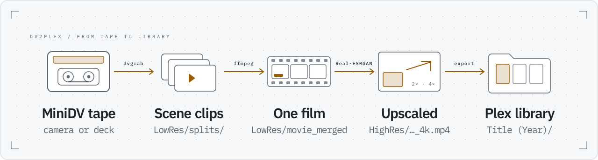

<picture>
  <source media="(prefers-color-scheme: dark)" srcset=".github/readme/banner-dark.svg">
  
</picture>

**MiniDV tapes to a Plex library.** DV2Plex captures tapes over FireWire, merges the parts,
upscales them with Real-ESRGAN, can generate a cover with Stable Diffusion, and exports the
result as `Title (Year)` into your Plex movie library. It runs as a desktop window or headless
on a server.

It is for anyone with a box of MiniDV tapes, a camera or deck that still plays them, a Linux
machine with a FireWire port, and a Plex server that should end up holding the films.

[How it works](#how-it-works) · [Quick start](#quick-start) · [Installation](#installation) · [Usage](#usage) · [Limits](#limits) · [Development](#development)

## Quick start

Linux with a FireWire port and a MiniDV camera or deck:

```bash
git clone https://github.com/FutureMan0/DV2Plex.git
cd DV2Plex
./setup.sh   # installs dvgrab, ffmpeg, the FireWire libraries and ./venv
./run.sh     # desktop window; add --server to run headless on port 5000
```

## How it works

<picture>
  <source media="(prefers-color-scheme: dark)" srcset=".github/readme/flow-dark.svg">
  
</picture>

1. **Capture** with dvgrab. Rewinds the tape, records it over FireWire and splits it into clips
   at every scene change, with a live preview while it records.
   → `DV_Import/<project>/LowRes/splits/`
2. **Merge** with ffmpeg. Joins the clips into one film and can burn in the recording date at
   the start of each scene.
   → `LowRes/movie_merged.*`
3. **Upscale** with Real-ESRGAN or ffmpeg, using one of five profiles from fast to highest
   quality. The 4× profiles end at 3840 × 2160.
   → `HighRes/<project>_4k.mp4`
4. **Cover** *(optional)* with Stable Diffusion. Picks frames from the film and turns one into
   a cover image.
   → `poster.jpg` next to the film
5. **Export** into the Plex movie library, film and poster, named the way Plex expects.
   → `<Title (Year)>/<Title (Year)>.mp4`

Each step can run on its own or follow the previous one automatically (`capture.auto_merge`,
`auto_upscale`, `auto_export` in the settings). Merges wait in a queue, which the
**Merge-Queue** tab shows.

## Installation

### Requirements

- **Linux.** Capture uses [dvgrab](https://linux.die.net/man/1/dvgrab), which only exists on Linux.
- **A FireWire (IEEE 1394) port** and a MiniDV camera or deck with a DV out.
- **Python 3.10+** and **ffmpeg**.
- **Disk space:** DV runs at about 13 GB per hour of tape, before upscaling.
- **A GPU** is optional, but Real-ESRGAN and Stable Diffusion are slow without one.

### With the setup script

```bash
./setup.sh
```

It installs what is missing through `apt`, `dnf` or `pacman`: Python 3.10+, pip, dvgrab,
ffmpeg and the FireWire libraries (`libraw1394`, `libavc1394`). Then it creates `./venv`,
installs `requirements.txt` into it and downloads Chromium for Playwright, which renders the
posters. Run it with `source setup.sh` to keep the virtual environment active afterwards.

### By hand

```bash
sudo apt install dvgrab ffmpeg libraw1394-dev libavc1394-dev  # Debian, Ubuntu
python3 -m venv venv
source venv/bin/activate
pip install -r requirements.txt
python -m playwright install chromium
```

The Real-ESRGAN weights are downloaded on first use into `dv2plex/bin/realesrgan/weights/`.

### Find the camera

```bash
./setup_device.sh    # runs dvgrab --list
```

Automatic detection usually works; if not, put the device into `device.firewire_device` in the
settings.

### Updating an installation

Older versions kept their settings in `dv2plex/config/settings.json`, a file that is also part
of the repository. On its first start, the current version copies that file to
`dv2plex/config/settings.local.json` if you had changed it, and does not touch it after that.
The built-in updater resets the old file to the repository version before each `git pull`, so a
later release can remove it from the repository without breaking the pull.

If you pull by hand and git stops because of local changes to `dv2plex/config/settings.json`,
keep your settings first:

```bash
cp -n dv2plex/config/settings.json dv2plex/config/settings.local.json
git checkout -- dv2plex/config/settings.json
git pull
```

## Usage

### Start

```bash
./run.sh                           # desktop window with its own local server
./run.sh --server --port 5000      # headless web server on all interfaces
./run.sh --url http://host:5000    # desktop window for a server running elsewhere
./run.sh --share                   # desktop window, server also reachable on the LAN
```

`python -m dv2plex` takes the same options. `./run.sh --no-gui` starts the server through `sudo`,
so dvgrab and the camera control keep their rights for the whole session.

### Capture a tape

1. Connect the camera over FireWire and switch it to playback (VCR) mode.
2. Start DV2Plex and open the **Digitalisieren** (capture) tab.
3. Enter the title and the year. They become the project name and, later, the Plex folder.
4. Optionally start the preview to check the connection.
5. Start the recording. DV2Plex rewinds the tape and records until you stop it or the tape ends.

The merge starts by itself when the recording ends (`capture.auto_merge`). Upscaling, covers and
the export run from their own tabs, or automatically if you switch them on.

### The interface

The web interface is in German. Its tabs, in order:

| Tab | What it is for |
| :-- | :-- |
| Digitalisieren | Capture: preview, record, rewind, play, pause |
| Upscaling | Upscale merged films with a profile |
| Cover Gen | Extract frames and generate a cover |
| Plex Export | Export single films or all of them |
| Merge-Queue | Merges that are waiting or running |
| Video Player | Watch, rename and delete projects |
| Logs | Live log of every step |
| Einstellungen | Paths, profiles, automation, updates |

### Configuration

Settings live in `dv2plex/config/settings.local.json`, which is created on the first start and
ignored by git, and can be changed in the **Einstellungen** tab.
Missing keys fall back to the defaults in [`dv2plex/config.py`](dv2plex/config.py), and
[`config/examples/example_configuration.json`](config/examples/example_configuration.json)
shows a complete file.

| Key | Meaning |
| :-- | :-- |
| `paths.dv_import_root` | Where captures, merges and upscaled films are kept |
| `paths.plex_movies_root` | Your Plex movie library, the export target |
| `paths.ffmpeg_path` | ffmpeg binary; empty uses the one on `PATH` |
| `paths.realesrgan_path` | Real-ESRGAN video script; found automatically |
| `upscaling.default_profile` | Profile used when none is chosen |
| `capture.auto_merge`, `auto_upscale`, `auto_export` | Run the next step automatically |
| `capture.timestamp_overlay` | Burn the recording date into the film |
| `update.enabled` | Automatic updates, see [Limits](#limits) |

### Upscaling profiles

| Profile | Backend | Use |
| :-- | :-- | :-- |
| `realesrgan_4x_hq` | Real-ESRGAN, 4× | Highest quality, slowest |
| `realesrgan_4x_balanced` | Real-ESRGAN, 4× | Between quality and speed |
| `realesrgan_4x_fast` | Real-ESRGAN, 4× | Faster, slightly lower quality |
| `realesrgan_2x` | Real-ESRGAN, 2× | Default; fast |
| `ffmpeg_fast` | ffmpeg only | Very fast, plain scaling |

The 4× profiles end at 3840 × 2160; `realesrgan_2x` keeps Real-ESRGAN's 2× output. The
parameters of each one are in [docs/Upscaling_Profile_Referenz.md](docs/Upscaling_Profile_Referenz.md).

## Limits

Worth knowing before you run it:

- **Capture is Linux-only.** It depends on dvgrab. `setup.bat` and `run.bat` exist for Windows,
  but without dvgrab there is no capture there.
- **No login.** Anyone who can reach the web interface can start captures, change settings,
  browse folders, run `sudo chown -R` on a path and trigger an update. The headless server
  listens on all interfaces by default. Run it only on a network you trust.
- **Notifications go to a public topic.** When a capture or merge finishes, a message with the
  title and year is posted to the public [ntfy.sh](https://ntfy.sh) topic `dv2plex-complete`,
  which anyone can subscribe to.
- **It updates itself.** Every 60 minutes it checks the Git remote it was cloned from and, if
  there is something new, runs `sudo git pull` and `sudo systemctl restart dv2plex`. It skips the update while a
  capture or merge is running. Set `update.enabled` to `false` to switch it off.
- **It needs `sudo` for dvgrab** unless it runs as root, and asks without a prompt (`sudo -n`).
  Either allow dvgrab without a password or start it with `./run.sh --no-gui`.
- **The interface is German only.**
- **No automated tests for capture, merge or upscaling.** They need a camera and real
  footage. The tests in `dv2plex/test_*.py` cover the settings and the updater; see
  [CONTRIBUTING.md](CONTRIBUTING.md#tests) for how to run them.

## Troubleshooting

**ffmpeg not found.** Install it system-wide, or put a static build into `dv2plex/bin/ffmpeg/bin/`.

**The camera is not found.** Run `./setup_device.sh`. If dvgrab lists nothing, check the
FireWire card with `lsmod | grep firewire` and the cable; the camera must be in playback mode.

**Upscaling is too slow.** Use a faster profile such as `realesrgan_2x` or `ffmpeg_fast`, or a
machine with a GPU.

## Development

### Project layout

```
DV2Plex/
├── dv2plex/                 Python package
│   ├── cli.py               command line: desktop, --server, --url
│   ├── web_app.py           FastAPI server and API
│   ├── desktop_app.py       pywebview window
│   ├── service.py           ties the steps together
│   ├── capture.py           dvgrab capture, preview, merge queue
│   ├── merge.py             joining clips, date overlay
│   ├── upscale.py           Real-ESRGAN and ffmpeg upscaling
│   ├── frame_extraction.py  frames for the cover
│   ├── cover_generation.py  Stable Diffusion cover
│   ├── poster_generation.py poster rendering (Playwright)
│   ├── plex_export.py       export into the Plex library
│   ├── update_manager.py    self-update via git
│   ├── web/                 the web interface (HTML, CSS, JS)
│   └── bin/realesrgan/      Real-ESRGAN, vendored (BSD 3-Clause)
├── config/examples/         example configuration
├── docs/                    build guide, upscaling profiles
├── scripts/                 PyInstaller build
├── setup.sh, run.sh         Linux setup and start
└── setup.bat, run.bat       Windows setup and start
```

### Set up

```bash
python3 -m venv venv
source venv/bin/activate
pip install -r requirements.txt
python -m dv2plex
```

### Build a standalone app

```bash
./scripts/build.sh
```

Details are in [docs/BUILD_ANLEITUNG.md](docs/BUILD_ANLEITUNG.md).

### Contributing

Issues and pull requests are welcome; see [CONTRIBUTING.md](CONTRIBUTING.md).

## License

MIT, see [LICENSE](LICENSE); notices for third-party code are in
[THIRD_PARTY_NOTICES.md](THIRD_PARTY_NOTICES.md). DV2Plex builds on [Real-ESRGAN](https://github.com/xinntao/Real-ESRGAN),
[ffmpeg](https://ffmpeg.org/), [dvgrab](https://linux.die.net/man/1/dvgrab),
[FastAPI](https://fastapi.tiangolo.com/), [pywebview](https://pywebview.flowrl.com/),
[PyTorch](https://pytorch.org/) and [Diffusers](https://github.com/huggingface/diffusers).
